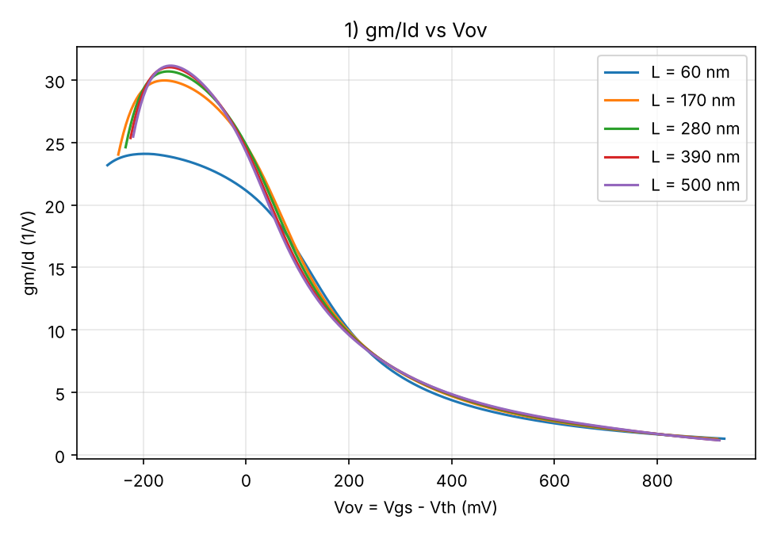
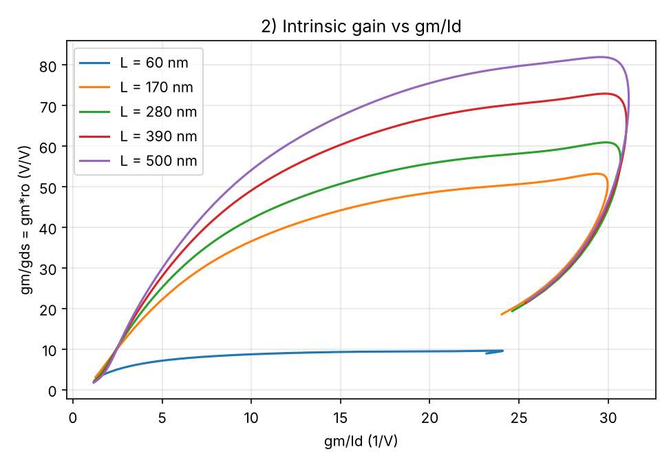
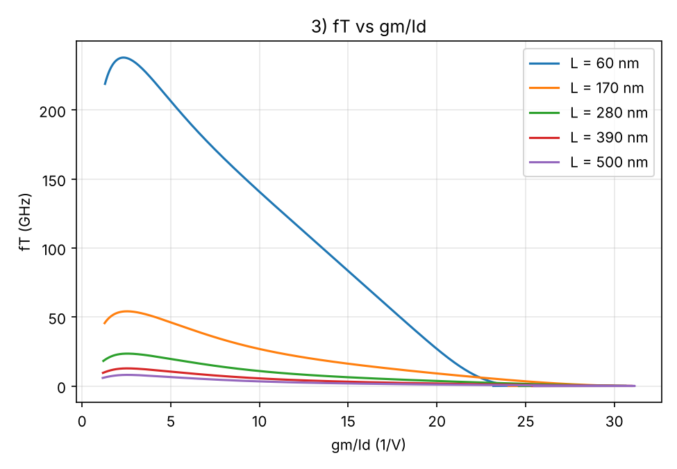
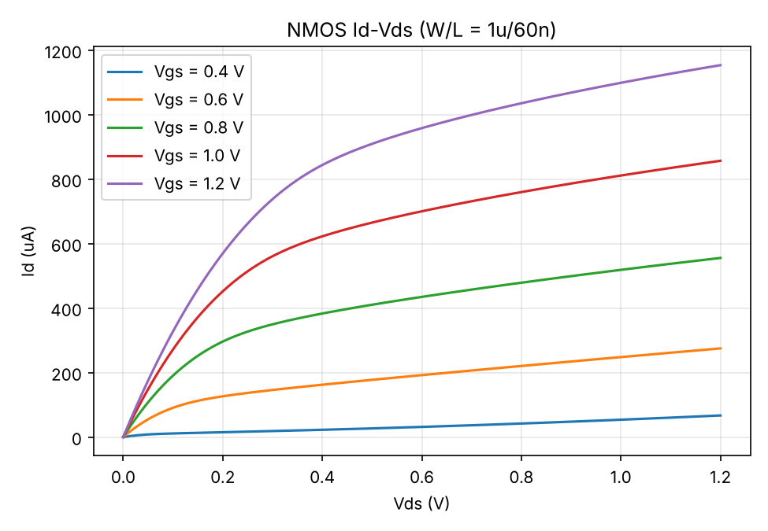
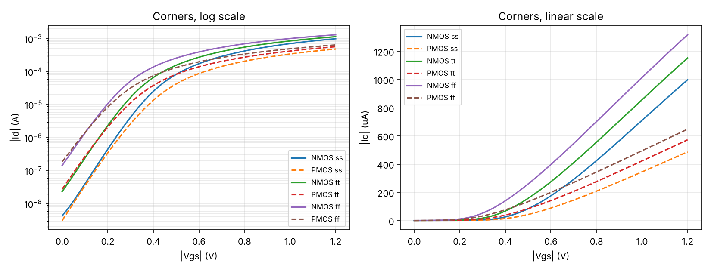
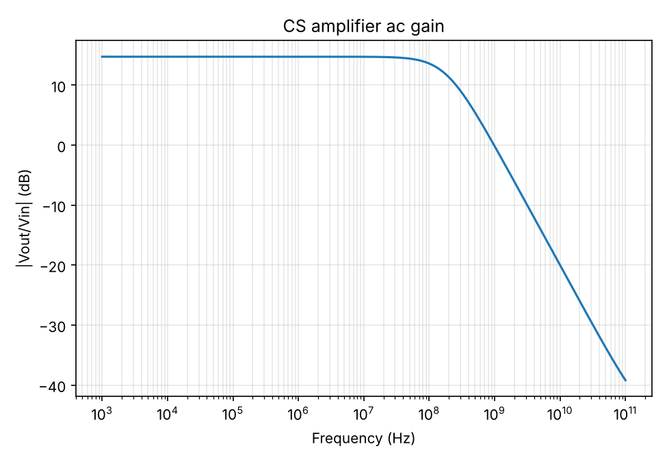

# cadence-study

My work for learning Cadence Virtuoso and Spectre. I characterized the NMOS and
PMOS core devices (nch / pch) of a 65 nm kit, built gm/Id tables, simulated a
small common-source amplifier and ran the tt / ss / ff corners. I also made a
small Virtuoso library with the devices and test benches using a SKILL script.

The model files are from the lab PDK, so they are not in this repo. Only my
netlists, scripts, notes and the results are here.

## Folders

```
spectre/    Spectre test benches (netlists)
python/     post-processing: reads the psf results, makes tables and plots
virtuoso/   SKILL script that builds the library gmid_study, and a guide for ADE
notes/      my notes on Virtuoso, MOSFET basics and compact models
results/    summary.txt, checks.txt and the gm/Id tables (csv)
plots/      all figures
```

Test benches:

- `nmos_iv.scs`, `pmos_iv.scs`: Id-Vds and Id-Vgs curves
- `gm_id_sweep.scs`: Id, gm, gds and Cgg vs Vgs for L = 60, 170, 280, 390, 500 nm
- `cs_amplifier.scs`: CS stage with 10k load, op / ac / noise / tran
- `corners.scs`: Id-Vgs at tt, ss and ff
- `check_setup.scs`: short op point to see if the models load

## Results

NMOS, W/L = 1u/60n:

| | value |
|---|---|
| Vth (saturation) | 0.215 V |
| DIBL | 141 mV/V |
| subthreshold swing | 98 mV/dec |
| Id at Vgs = Vds = 1.2 V | 1154 uA/um |

gm/Id data (W = 1 um, Vds = 0.6 V):

| L (nm) | max gm/Id | max fT (GHz) | gm/gds at gm/Id = 15 |
|---|---|---|---|
| 60 | 24.1 | 238 | 9.3 |
| 170 | 30.0 | 54 | 44.2 |
| 280 | 30.7 | 23.5 | 50.7 |
| 390 | 31.0 | 12.8 | 60.3 |
| 500 | 31.2 | 8.1 | 67.4 |

Short L is fast but has low intrinsic gain, long L is the other way round.
The PMOS needs about 2.9x more width than the NMOS for the same current
density at gm/Id = 15.

CS amplifier (W/L = 2u/180n, RL = 10k, CL = 100f): gain 5.46 V/V (14.7 dB),
-3 dB bandwidth 183 MHz.

All numbers are in `results/summary.txt`.








## How to run

On the server, with the Cadence tools loaded:

```
csh
source /mnt/cadence_tools/cshrc
bash go.sh
```

`go.sh` looks for the model file (or asks for the path), runs all benches,
checks the numbers, builds the Virtuoso library and copies everything to `out/`.
It takes 5 to 15 min.

The server has no matplotlib, so I make the plots on my PC:

```
python python/analyze_spectre.py
```

If you get `$'\r': command not found`, the files went through Windows:
`sed -i 's/\r$//' *.sh spectre/* python/* virtuoso/*`

## Things I learned

- PMOS benches must be referred to the source (gate = VDD - VSG), otherwise the
  real VSG changes during the sweep
- In this kit `nch` is a subckt, so `M0:gm` does not work at the top level. I took
  gm, gds and Cgg from terminal currents of a dc + ac sweep instead
- For the transient, the sine offset is `sinedc`, not `dc`
- The CS amp needs two passes: first find the bias for V(out) = VDD/2, then run ac / noise / tran

## To do

- temperature and supply corners
